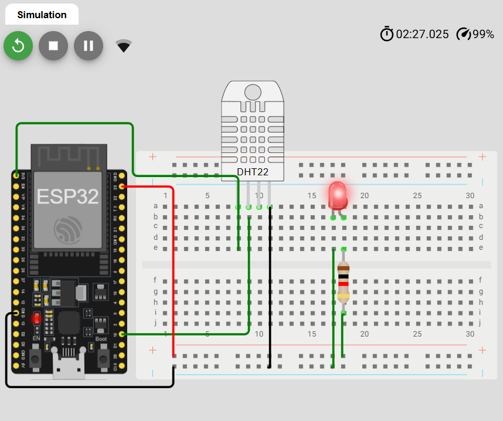

# ESP32 -> ThingSpeak: Temperature & Humidity Monitor

**Student Name:** Jana Jawabreh
**University ID:** 12324675

## Project Description

This project simulates an ESP32 reading temperature and humidity from a DHT22 sensor and sending the readings to ThingSpeak every 20 seconds over Wi-Fi The data is displayed on public ThingSpeak charts

The University ID is printed in the Serial Monitor log with every reading, for example:

```
[Jana_Jawabreh | ID: 12324675] Temp: 25.0 C, Hum: 50.0 % -> Data Sent to ThingSpeak
```

**Extra feature:** an LED on GPIO 23 turns on when the temperature is above 30 °C and turns off otherwise

## Links

- **ThingSpeak public channel:** https://thingspeak.com/channels/3551173
- **Wokwi project:** https://wokwi.com/projects/478953607476125697

## Repository Structure

```
esp32-thingspeak/
├── sketch.ino
├── diagram.json
├── screenshots/
│   ├── thingspeak.png
│   ├── serial.png
│   └── circuit.png
└── README.md
```

## Hardware / Simulation

Simulated in [Wokwi](https://wokwi.com/) (ESP32 + DHT22).

| Component | Pin |
|-----------|-----|
| DHT22 VCC | 3V3 |
| DHT22 DATA (SDA) | GPIO 15 |
| DHT22 GND | GND |
| LED (via resistor) | GPIO 23 |

## ThingSpeak Channel

- **Name:** Jana_Jawabreh_12324675
- **Field 1:** Temperature (°C)
- **Field 2:** Humidity (%)
- **Visibility:** Public

## Libraries

- ThingSpeak (MathWorks)
- DHT sensor library


## How to Run

1. Open the Wokwi project, or copy `sketch.ino` into a new Wokwi ESP32 project
2. Replace `MY_API_KEY` with your own ThingSpeak Write API Key
3. Press Play and open the Serial Monitor
4. Check the charts on the ThingSpeak channel page.

## Wiring Diagram



## Screenshots

| Screenshot | File |
|------------|------|
| ThingSpeak channel with live charts | `ScreenShots/thingspeak.png` |
| Serial Monitor output | `ScreenShots/serial.png` |
| Wokwi circuit | `ScreenShots/circuit.png` |

## Note

The Write API Key is not included in this repository for security reasons
